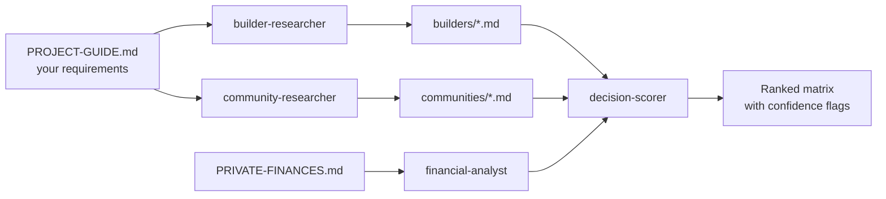

# Home Buyer Guide

**Research a home purchase with an AI agent team, without handing over your finances.**

Buying a home means comparing dozens of builders, communities and price sheets that never line up, while the rules on rates and rebates keep changing. This project gives Claude Code a structured workflow for that: specialist subagents research each option into one consistent schema, a scorer ranks them with *your* weights, and a calculator shows the math. Your personal data stays on your machine.

> Not financial advice. Confirm anything important with a licensed mortgage broker, lawyer or accountant.

## Why it's different

- **Same schema every time.** Every builder and community file has identical fields, so parallel research is comparable and scoreable.
- **Honest about what it doesn't know.** Unknowns are `null`. Every figure carries a source and date, plus a `data_confidence` rating. Agents are told never to invent numbers.
- **First-hand beats website.** Show-home visits and real quotes outrank "starting from" pricing.
- **Rules are re-verified, not remembered.** Stress-test rates and program limits are looked up each time and cited, because they go stale.
- **Private by default.** Finances, requirements, shortlist and field notes are gitignored; only the method is shared.

## How it works



| Piece | Role |
|---|---|
| `.claude/agents/builder-researcher.md` | Researches one builder into the schema |
| `.claude/agents/community-researcher.md` | Researches one community into the schema |
| `.claude/agents/decision-scorer.md` | Scores options, flags stale or conflicting data |
| `.claude/agents/financial-analyst.md` | Affordability and stress-test math, inputs always shown |
| `docs/framework.md` | Schema, scoring method, programs-and-rules log |
| `scripts/affordability.py` | Standalone payment and stress-test calculator |
| `examples/` | Fictional sample outputs showing what the agents produce |

## Quick demo (30 seconds, no setup)

```bash
python3 scripts/affordability.py --price 750000 --down 100000 \
  --rate 4.5 --years 25 --stress-rate 6.5 --monthly-income 15000
python3 -m unittest discover -s tests
```

Rates are always inputs; the tool never assumes one. See `examples/` for the kind of research files the agents write.

## Use it for your own search

1. Clone this repo and open it in Claude Code.
2. `cp PRIVATE-FINANCES.template.md PRIVATE-FINANCES.md` and `cp PROJECT-GUIDE.template.md PROJECT-GUIDE.md`, then fill both in. They're gitignored.
3. Ask Claude to research a builder or community, then ask the decision-scorer to build the matrix.

## Limitations

- The calculator uses monthly compounding. Canadian fixed mortgages typically compound semi-annually, so results differ slightly.
- It excludes mortgage default insurance, property tax, utilities and closing costs.
- Agent output depends on public web sources; check `data_confidence` and sources before relying on a number.

## Roadmap

- Semi-annual compounding and default-insurance premium options
- Closing-cost estimator per jurisdiction
- Side-by-side comparison report as a shareable page
- Intake agent for photos, PDFs and voice notes from show-home visits

## Contributing

Issues and PRs are welcome. Please never include real personal finances, quotes or addresses in examples; use clearly fictional data.

## License

MIT. See `LICENSE`.
