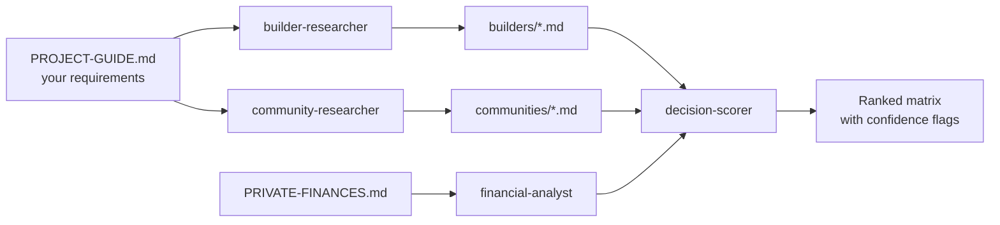

# Home Buyer Guide

**Research a home purchase with an AI agent team, without handing over your finances.**

Buying a home means comparing dozens of builders, communities and price sheets that never line up, while the rules on rates and rebates keep changing. This project gives Claude Code a structured workflow for that: specialist subagents research each option into one consistent schema, a scorer ranks them with *your* weights, and a calculator shows the math. Your personal data stays on your machine.

> Not financial advice. Confirm anything important with a licensed mortgage broker, lawyer or accountant.

## Why it's different

- **Same schema every time.** Every builder and community file has identical fields, so parallel research is comparable and scoreable.
- **Honest about what it doesn't know.** Unknowns are `null`. Every figure carries a source and date, plus a `data_confidence` rating. Agents are told never to invent numbers.
- **First-hand beats website.** Show-home visits and real quotes outrank "starting from" pricing.
- **Rules are re-verified, not remembered.** Stress-test rates and program limits are looked up each time and cited, because they go stale.
- **Private by default.** Finances, requirements, shortlist and field notes are gitignored; only the method is shared.

## How it works



| Piece | Role |
|---|---|
| `.claude/agents/builder-researcher.md` | Researches one builder into the schema |
| `.claude/agents/community-researcher.md` | Researches one community into the schema |
| `.claude/agents/decision-scorer.md` | Scores options, flags stale or conflicting data |
| `.claude/agents/financial-analyst.md` | Affordability and stress-test math, inputs always shown |
| `docs/framework.md` | Schema, scoring method, programs-and-rules log |
| `scripts/affordability.py` | Canadian mortgage calculator: semi-annual compounding, default insurance, stress test, Alberta title fees |
| `data/rules-ca-ab.json` | Dated, sourced rules snapshot the calculator reads (re-verify before relying on it) |
| `scripts/build_report.py` | Turns research files into a shareable HTML comparison report |
| `examples/calgary/` | Worked example: Glacier Ridge, Calgary, from public sources |
| `demo/` | One-command demo and a 90-second recording script |

**Live demo report:** https://ubatavia.github.io/home-buyer-guide/

## Quick demo (30 seconds, no setup)

```bash
./demo/run_demo.sh          # research file, affordability math, tests, HTML report
open demo/report.html       # macOS; the script opens it for you
```

It runs a real Calgary example (Glacier Ridge, two builders, four same-size floor plans) built from public sources. The household in the scenario is fictional. Every price carries a source and date, and anything unverified is marked `low` confidence or `unknown`. See `demo/DEMO-SCRIPT.md` for a recording script.

Calculator on its own:

```bash
python3 scripts/affordability.py --price 725000 --down 72500 --rate 4.0 --years 25 \
  --insured --first-time --stress-auto --monthly-income 12500
```

## Use it for your own search

1. Clone this repo and open it in Claude Code.
2. `cp PRIVATE-FINANCES.template.md PRIVATE-FINANCES.md` and `cp PROJECT-GUIDE.template.md PROJECT-GUIDE.md`, then fill both in. They're gitignored.
3. Ask Claude to research a builder or community, then ask the decision-scorer to build the matrix.

## Limitations

- The rules file was compiled from secondary sources (news, lenders, law firms), not primary government pages. Several values are flagged for verification, such as the insured-mortgage price cap.
- The calculator excludes property tax, utilities, legal fees, GST rebates and closing adjustments. It is a screening tool, not a lender's calculation.
- Builder prices in the Calgary example are "starting from" marketing figures. No show-home visit or quote backs them.
- Agent output depends on public web sources; check `data_confidence` and sources before relying on a number.

## Roadmap

- Primary-source rules verification step in the financial-analyst agent
- Closing-cost estimator, including GST rebate handling
- Other provinces' rules files alongside `data/rules-ca-ab.json`
- Intake agent for photos, PDFs and voice notes from show-home visits

## Contributing

Issues and PRs are welcome. Please never include real personal finances, quotes or addresses in examples; use clearly fictional data.

## License

MIT. See `LICENSE`.
